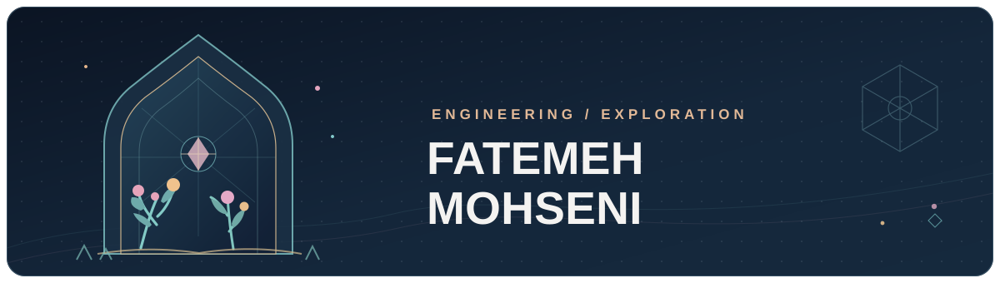

  

<h1 align="center">Hi, I'm Fatemeh.</h1>

<strong>Software Engineer · AI Systems · Computer Vision</strong>

  I build thoughtful software at the intersection of intelligent systems, backend engineering, and interactive experiences.

  <a href="https://github.com/fatemeh-mohseni-AI?tab=repositories">Explore my repositories</a>
  &nbsp;·&nbsp;
  <a href="https://github.com/fatemeh-mohseni-AI/Fatemeh-Website">Explore my digital garden</a>

---

### What I build?

- **AI & computer vision:** object detection, instance segmentation, annotation workflows, and practical ML tooling.
- **Backend systems:** APIs, asynchronous services, containerized deployments, and secure integrations.
- **Creative engineering:** interactive web experiences that connect software, storytelling, and visual design.

### Selected work

**[Odoo 17 Project Management MCP](https://github.com/fatemeh-mohseni-AI/Odoo17-Project_management-MCP)**  
A project-scoped MCP server connecting AI agents to Odoo 17 project management, with authenticated access, explicit permission boundaries, and Docker-based deployment.  
`Python` · `MCP` · `Odoo` · `Docker` · `API Security`

**[Cambridge IELTS PDF Analyzer](https://github.com/fatemeh-mohseni-AI/most-repeated-vocabulary-IELTS)**  
A FastAPI application that extracts and analyzes vocabulary from text-based and scanned PDFs using OCR and NLP tooling.  
`Python` · `FastAPI` · `OCR` · `NLP` · `SQLite`

**[Pixel Garden](https://github.com/fatemeh-mohseni-AI/pixel-garden)**  
An interactive pixel-art world that turns public GitHub repositories into distinctive plants, with repository details, day/night scenes, and accessible interactions.  
`TypeScript` · `Interactive UI` · `Data Visualization`

**[Fatemeh's Digital Garden](https://github.com/fatemeh-mohseni-AI/Fatemeh-Website)**  
An immersive personal website bringing together Persian-inspired design, a navigable courtyard, a library, a gallery, and interactive explorations.  
`TypeScript` · `React` · `Three.js` · `Frontend Engineering`

### Engineering toolbox!

**Languages:** `Python` · `TypeScript` · `JavaScript` · `SQL`  
**Backend & infrastructure:** `Django` · `FastAPI` · `PostgreSQL` · `Docker` · `Linux`  
**AI & vision:** `PyTorch` · `OpenCV` · `YOLO` · `Computer Vision`  
**Interactive web:** `React` · `Three.js`

### What I'm exploring

Reliable AI-assisted workflows, computer-vision pipelines, and expressive digital experiences. I like projects where sound engineering and curiosity reinforce one another.

---

  <em>Build with rigor. Explore with curiosity.</em>

